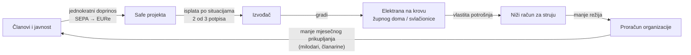

# 02 — Pilot: sunčane elektrane za župe i klubove

Pilot su župe (2.926) i nogometni klubovi (1.014), a prvi tip projekta je sunčana
elektrana na nekretnini koju organizacija već ima: župni dom, crkva, svlačionica,
klupske prostorije. Korist je odmah: niži račun za struju znači manje režija, a režije
organizacije ionako svaki mjesec pokrivaju ti isti članovi.

Zato je jedan projekt po organizaciji dovoljan za pilot. Svaka župa i svaki klub imaju
barem jednu zgradu sa strujnim računom, pa je ponuda projekata gotovo jednaka broju
točaka na karti.

| Što | Pilot odluka | Izvor |
| --- | --- | --- |
| Pravni model | A, doprinos kolektivnom korisniku: podržavatelj ne dobiva novac, korist je niža režija zajednice | `energy.domovina.ai/docs/03` §4 |
| Korisnik | župa ili udruga (klub), ne fizička osoba: tada je model čist | isto, tablica „Tko smije primati” |
| Višak sredstava | organizacija prije prelaska cilja daje izjavu o namjeni viška; neutrošeno može postati oporezivo | isto, „Zamka viška sredstava” |
| Isplata | po situacijama izvođača, iz Safea 2 od 3 | `energy.domovina.ai/docs/04` §3, `docs/15` |
| Referentna veličina | Lukavec 16 kW / 11.200 € (procjena vlasnika, ne ponuda) | `energy.domovina.ai/docs/15` §2 |

Platforma ne uzima postotak. Ako domovina.energy gradi elektranu kao izvođač, to mora
pisati uz projekt, s javnom cijenom izvedbe (`energy.domovina.ai/docs/04` §4.1).
Inače „besplatna infrastruktura” postaje oboriva tvrdnja.
