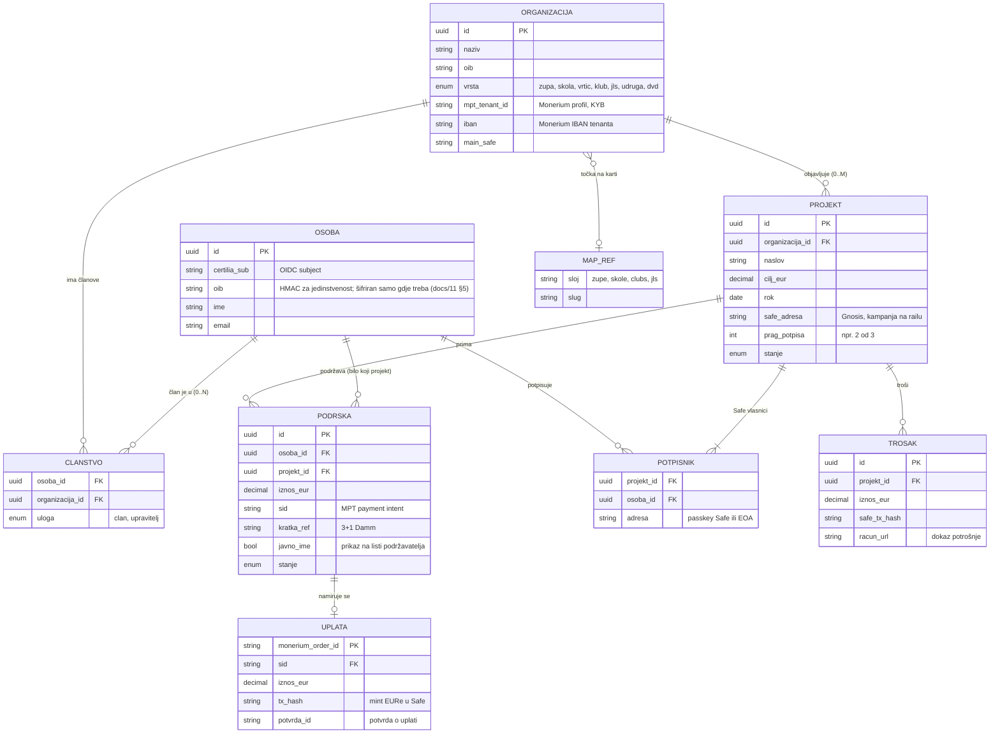

# 03 — Domenski model

Osoba podržava projekt izravno, a članstvo je samo kontekst. Podrška visi na osobi i
projektu. Članstvo služi za označavanje („član ove župe”), obavijesti i prava
upravljanja, ali nije uvjet za podršku.

| Entitet | Kardinalnost | Značenje | U MPT railu |
| --- | --- | --- | --- |
| Osoba | 0..N članstava, 0..K podrški | prijava Certilijom, OIB potvrđen | uplatitelj; potvrda o uplati vezana uz njegov ključ |
| Organizacija | 0..M projekata | zajednica s karte (`map_ref` = sloj + slug) | MPT tenant: vlastiti Monerium profil (KYB), IBAN, glavni Safe |
| Članstvo | 0..1 po (osoba, organizacija) | član ili upravitelj; nije uvjet za podršku | — |
| Projekt | 0..K podrški | cilj, rok, opis, izvješća | vlastiti Safe `<tenant>-<projekt>` = kampanja |
| Potpisnik | 2..n po projektu | tko odobrava trošenje (župnik, ekonom, član vijeća) | vlasnik Safea, prag npr. 2/3 |
| Podrška | 1 osoba, 1 projekt | namjera + iznos | payment intent (`sid`, kratka referenca) |
| Uplata | 1 po podršci (± povrat) | stvarni novac | Monerium order + EURe tx na Gnosisu |
| Trošak | 0..n po projektu | izlaz iz Safea + račun | Safe transakcija (redeem na IBAN dobavljača) |

Ograničenja:

1. Saldo projekta je saldo njegovog Safea na lancu. Baza ga ne knjiži, nego ga čita i kešira.
2. Platforma nikad ne drži novac ni ključ koji ga miče. Uplata ide izravno u Safe projekta (izravni mint, bez forwarda), a troši se samo potpisima organizacije.
3. Jedna osoba ima najviše jedno članstvo po organizaciji (`UNIQUE(osoba_id, organizacija_id)`).
4. Projekt smiju otvoriti samo upravitelji organizacije, a organizacija mora imati aktivan MPT tenant (KYB prošao kod Moneriuma).
5. Glasovanje ne pomiče novac. Odluka glasovanja je mandat; Safe i dalje troše samo potpisnici (`docs/10` §1).

**Glasovanje (plan, `docs/13` faza 3).** Entiteti `GLASOVANJE` (organizacija, hash
definicije, adresa instance na lancu) i `PRESJEK_CLANOVA` (Merkle korijen oznaka i broj
članova u trenutku otvaranja) još nisu u dijagramu; dodaju se kad se faza 3 razradi.
Članstvo kao biračko tijelo uvodi novu točku povjerenja: upravitelj vodi popis
(`docs/10` §1).

## ER dijagram

`TROSAK` je ono što lokalnu platformu razlikuje od generičkog crowdfundinga. Svaki
izlaz iz Safea je javan na lancu, a uz njega ide račun.
