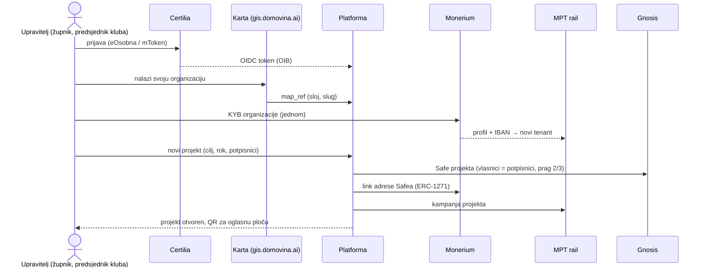
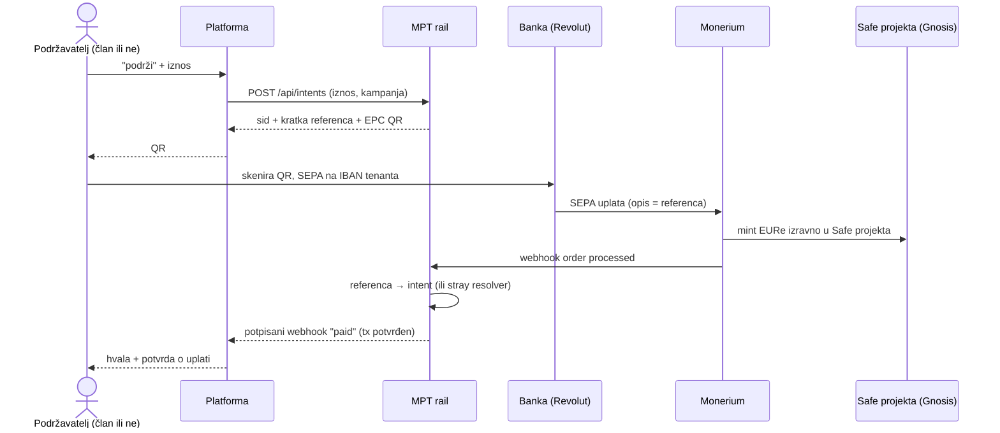
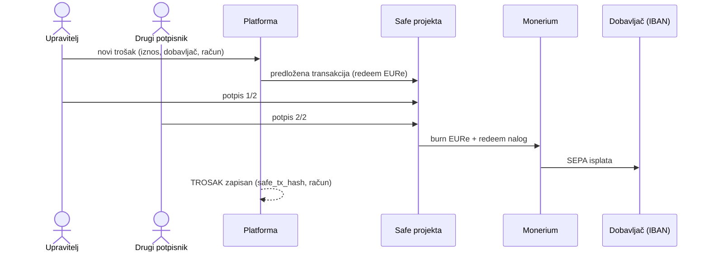

# 04 — Ključni tokovi

Tri toka nose cijelu platformu: organizacija ulazi i otvara projekt, bilo tko
podržava, organizacija troši. Novac nikad ne prolazi kroz platformu.

## 1. Organizacija ulazi i otvara projekt

Upravitelj se prijavi Certilijom, preuzme točku s karte i prođe KYB kod Moneriuma. Za
svaki projekt `pay.domovina.ai/tools/funding` (idempotentno) kreira Safe s potpisanom
Monerium porukom, linka ga na Monerium i registrira kampanju na railu.

## 2. Podrška projektu (bilo tko)

Podržavatelj ne treba ni članstvo ni kriptonovčanik. Skenira QR u Revolutu ili
mobilnom bankarstvu i plati SEPA uplatu. Certilia je potrebna samo za potvrdu na ime i
ime na listi podržavatelja (otvoreno pitanje, `docs/08`).

## 3. Trošenje

