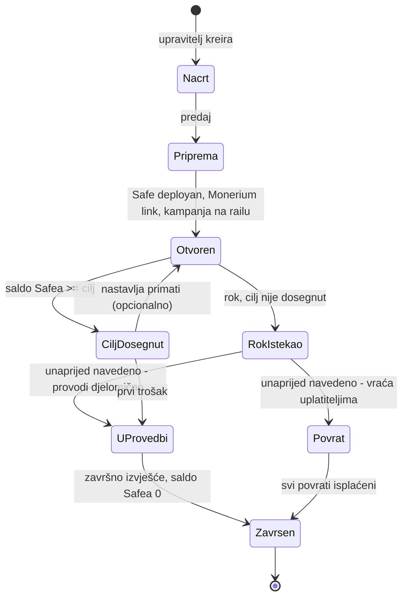
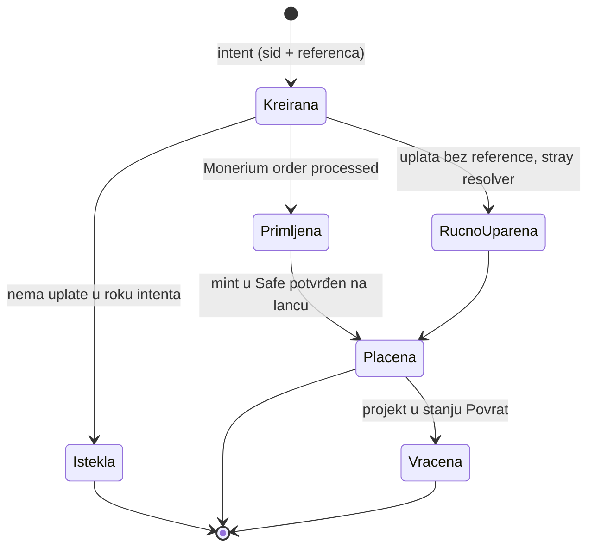

# 05 — Životni ciklus

Novac stiže u Safe odmah, pa nema „sve ili ništa” preko autorizacija. Rok i cilj su
javno obećanje organizacije; što se događa s novcem ako cilj nije dosegnut,
organizacija navodi unaprijed (izjava o namjeni viška, `docs/02`). Stanja podrške
preslikavaju stanja MPT intenta (`pay.domovina.ai/docs/state-machines.md`).

## Projekt

## Podrška

Povrat je skup: svaki je zasebna Safe transakcija s redeemom na IBAN uplatitelja.
Razumna zadana postavka je „novac ostaje projektu za istu namjenu”, a povrat samo kad
ga organizacija izričito obeća.
