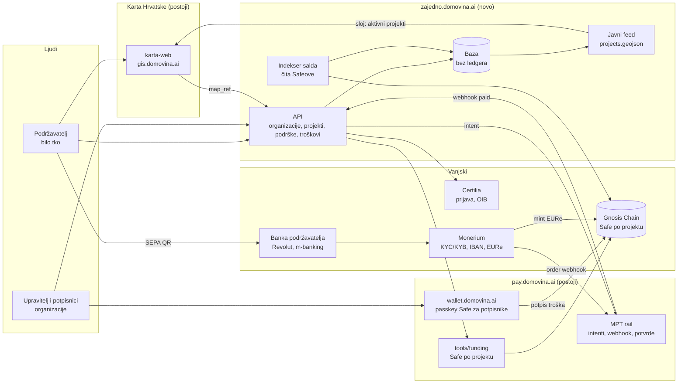

# 06 — Arhitektura sustava

Nova je samo tanka aplikacija: profili, organizacije, projekti, izvješća. Novac,
potvrde i on-chain dio već postoje u MPT railu, a karta je već imenik zajednica.

| Komponenta | Status | Odgovornost |
| --- | --- | --- |
| karta-web | postoji | imenik zajednica, ulaz preko točke na karti, sloj aktivnih projekata |
| MPT rail | postoji | payment intenti, Monerium webhook, potvrde o uplati, stray resolver |
| `tools/funding` | postoji (sandbox) | Safe po projektu, Monerium link, kampanja; treba API umjesto skripte |
| wallet.domovina.ai | postoji | passkey Safe kao potpisnički ključ upravitelja |
| API + baza | novo | organizacije, članstva, projekti, podrške, troškovi s računima |
| Certilia login | novo | OIDC prijava, OIB u profilu osobe |
| Indekser salda | novo | saldo i izlazi Safea s lanca, keš u bazi |

Veza s kartom je labava u oba smjera: karta šalje na stranicu organizacije preko
`map_ref`, a platforma vraća javni GeoJSON s aktivnim projektima po točki. Novi sloj
na karti mora ući u `SIBLING_LAYERS` u `karta-web/scripts/sync-data.mjs`.
