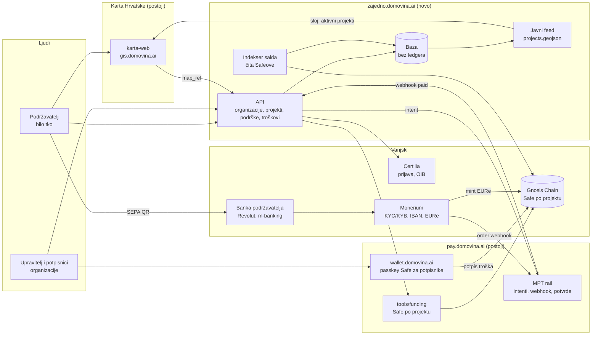

# 06 — Arhitektura sustava

Nova je samo tanka aplikacija: profili, organizacije, projekti, izvješća. Novac,
potvrde i on-chain dio već postoje u MPT railu, a karta je već imenik zajednica.

| Komponenta | Status | Odgovornost |
| --- | --- | --- |
| karta-web | postoji | imenik zajednica, ulaz preko točke na karti, sloj aktivnih projekata |
| MPT rail | postoji | payment intenti, Monerium webhook, potvrde o uplati, stray resolver |
| frontend kampanje | postoji u energyju (`/beta/`, `/sandbox/`) | popis i stranica kampanje, intent, status uživo, saldo s lanca; vidi niže |
| `tools/funding` | postoji (sandbox) | Safe po projektu, Monerium link, kampanja; treba API umjesto skripte |
| wallet.domovina.ai | postoji | passkey Safe kao potpisnički ključ upravitelja |
| API + baza | novo | organizacije, članstva, projekti, podrške, troškovi s računima |
| Certilia login | novo | OIDC prijava, OIB u profilu osobe |
| Indekser salda | novo | saldo i izlazi Safea s lanca, keš u bazi |

## Što već radi: energy `/sandbox/` (20. 10. 2026.)

`energy.domovina.ai/sandbox/` je kampanja doprinosa na tenantu `italk-sandbox`
(Monerium sandbox, Chiado). To je isti kod koji na `/beta/` prima pravi novac, a
banka se simulira. Izvor: `energy.domovina.ai/docs/17-sandbox-bijela-etiketa.md`,
commiti `05b2287`…`a65a218`.

Provjereno 20. 10. 2026.: intent `79efutma7cy5` (45,89 €) je `paid` 8 s nakon
stvaranja, memo `chiado:0xb7a3…241d sid:79efutma7cy5`, kratka referenca `1032`,
`forward_tx_hash: null` (izravni mint, bez forwarda) (`GET
mpt.domovina.ai/api/intents/79efutma7cy5`).

| Što treba ova platforma | Što postoji u energyju | Datoteka |
| --- | --- | --- |
| Popis projekata jedne organizacije | popis kampanja jednog tenanta, statički | `lib/sandbox-campaigns.ts`, `app/sandbox/page.tsx` |
| Stranica projekta: cilj, napredak, namjena po stavkama, potpisnici | stranica kampanje | `components/sandbox/sandbox-page.tsx` |
| Podrška točno tom projektu | intent s `Bearer pk_…` tenanta prema Safeu kampanje; rail odbija Safe koji nije kampanja | `lib/mpt-intent.ts` `createPaymentIntent` |
| Status uplate uživo | SSE `…/stream` + polling 2 s kao rezerva; `?uplata=<sid>` vraća isti intent nakon osvježavanja | `lib/mpt-intent.ts` `watchIntentStatus`, `components/beta/beta-page.tsx` |
| Saldo i popis uplata s lanca | `balanceOf` s RPC-a, dolazni EURe s Blockscouta | `lib/beta-chain.ts`, `lib/safe-rpc.ts` |
| „Moje podrške” bez računa | zadnje uplate iz `localStorage` ovog preglednika | `components/beta/my-receipts.tsx` |
| Profil raila (tenant, lanac, ključ) odvojen od koda | `RailProfile`: `RAIL_ITALK`, `RAIL_ITALK_SANDBOX` | `lib/rail-profile.ts` |
| Brend platforme | placeholder `WHITE_LABEL`, plan: konfiguracija po klijentu | `lib/white-label.ts`, `docs/17` §4 |

Pravila iz `docs/17` koja vrijede i ovdje: sandbox IBAN se nikad ne crta kao EPC
QR, sandbox nema potvrdu o uplati, a traka „sandbox” je obavezna.

Što energy **nema**, a ova platforma treba:

- **Organizacije i projekti su u kodu**, ne u bazi. Nova kampanja je
  `funding-init` + naredba u admin konzoli raila + zapis u `sandbox-campaigns.ts`
  + deploy. Za 2.926 župa i 1.014 klubova treba baza i API (`App` gore).
- **Tenant je ITalk.** `italk-sandbox` je ITalkov profil (primatelj „ITalk d.o.o.
  (sandbox)”), a `RailProfile.tenant` je tip `"italk" | "italk-sandbox"`.
  Tenant po organizaciji (vlastiti KYB, `docs/09`) nije isproban ni na sandboxu.
- **Javni ključ `pk_` je u JS paketu**, po jedan na tenanta. S tenantom po
  organizaciji ključ dolazi iz baze uz organizaciju, ne iz konstante.
- Certilia, članstva, troškovi s računima i lista podržavatelja s imenom.

Blueprint iz `docs/17` §4 predviđa jedan statički build po brendu. To ne pokriva
self-serve organizacije, ali komponente (`PayWithIntent`, `LiveActivity`,
`PendingWatcher`, `IntentPanel`) i `lib/mpt-intent.ts` su kandidati za preuzimanje.
Danas isti ugovor s railom već postoji u tri kopije (energy, solardei, checkout na
railu, `energy.domovina.ai/docs/2026-10-05-solardei-rail-i-zajednicka-jezgra.md`
§2), pa ova platforma ne bi smjela biti četvrta. Kako to izbjeći je otvoreno
pitanje (`docs/08`).

## Karta

Veza s kartom je labava u oba smjera: karta šalje na stranicu organizacije preko
`map_ref`, a platforma vraća javni GeoJSON s aktivnim projektima po točki. Novi sloj
na karti mora ući u `SIBLING_LAYERS` u `karta-web/scripts/sync-data.mjs`.
