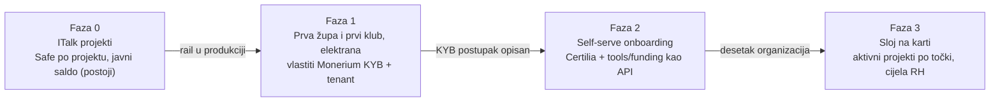

# 08 — Plan i otvorena pitanja

Rail, Safe po projektu i karta već rade, pa MVP nije novi sustav nego povezivanje
postojećeg. Projekti Karta Hrvatske i Stranke već imaju Safe i kampanju na sandboxu
(`pay.domovina.ai/docs/2026-10-11-funding-po-projektu.md`).

## Otvorena pitanja

- [ ] Koliko traje i što traži Monerium KYB za župu i za klub (udrugu)? To je najveće trenje onboardinga.
- [ ] Tko su potpisnici Safea: župnik + ekonom + član ekonomskog vijeća; predsjednik + blagajnik + član uprave kluba?
- [ ] Treba li župi suglasnost biskupije za elektranu na crkvenoj nekretnini, i može li to biti korak u onboardingu?
- [ ] Standardni tekst izjave o namjeni viška sredstava, jedan za sve projekte.
- [ ] Je li Certilia obavezna za podršku ili samo za potvrdu na ime i javnu listu podržavatelja?
- [ ] Prazan repo `domovinatv/funding.domovina.ai` (lokalno samo `.git`): obrisati ili preimenovati.
