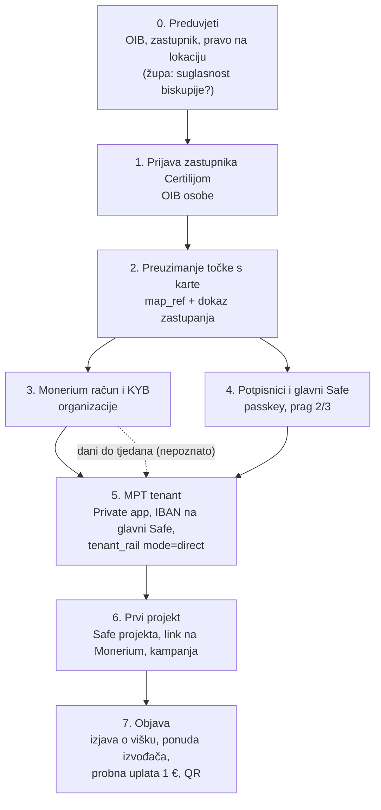

# 09 — Onboarding župe i kluba

Što organizacija mora proći od prve prijave do prve uplate na projekt. Najduži
korak je Monerium KYB, i to je jedini korak koji ne možemo ubrzati kodom. Sve
ostalo je danas djelomično ručno (operater ITalk), a Faza 2 (`docs/08`) ga
pretvara u self-serve.

Uz svaki korak stoji je li **provjereno** (s putem do izvora) ili
**pretpostavka** (treba potvrditi prije prve župe ili kluba).

## Tok

Koraci 3 i 4 teku paralelno: dok Monerium pregledava KYB, potpisnici postavljaju
passkeyeve.

## 0. Preduvjeti

| Što | Župa | Nogometni klub | Status |
| --- | --- | --- | --- |
| Pravna osoba s OIB-om | da; upisana u Evidenciju pravnih osoba Katoličke Crkve (Ministarstvo pravosuđa i uprave) | obično udruga u Registru udruga; dio klubova je sportsko dioničko društvo | župa: zapisano u `solardei-hr/docs/08` §4, nije provjereno kod Moneriuma; klub: **pretpostavka** |
| Zakonski zastupnik | župnik | predsjednik (ili osoba iz statuta) | **pretpostavka** za klub |
| Stvarni vlasnik za KYB | nema vlasnika, pa „senior managing official” = župnik | isto načelo, predsjednik | **pretpostavka**, „provjeriti s Moneriumom” (`solardei-hr/docs/08` §4) |
| Suglasnost nadređenih | možda suglasnost biskupije (izvanredna upravna radnja, razlikuje se po biskupijama) | nema | **otvoreno**, `docs/08` |
| Pravo na lokaciju elektrane | vlasništvo ili pravo građenja na krovu | često je teren i zgrada u vlasništvu grada, pa treba suglasnost vlasnika | zahtjev E6 iz `energy.domovina.ai/docs/03` §8; za klub **pretpostavka** da je vlasnik često JLS |

Nadbiskupija kao jedan tenant za sve župe **ne radi**: župe su zasebne pravne
osobe, pa bi primanje za njih bilo „u ime trećeg” (Monerium ToS §16,
`solardei-hr/docs/08` §4). Isto vrijedi za savez kao tenant za klubove.

## 1. Prijava zastupnika Certilijom

Zastupnik se prijavi Certilijom (eOsobna ili mToken). Platforma dobiva OIB osobe i
stvara `OSOBA` (`docs/03`).

- **Status:** novo, Certilia OIDC još nije integriran u ovaj projekt.
  `energy.domovina.ai/docs/03` E7 traži eID provjeru nositelja prije objave i
  kaže da se provjera računa na serveru, nikad iz klijenta.

## 2. Preuzimanje točke s karte

Zastupnik nađe svoju župu ili klub na karti i zatraži upravljanje. Platforma
stvara `ORGANIZACIJA` s `map_ref` (sloj `zupe` ili `clubs` + slug) i
`CLANSTVO` s ulogom `upravitelj`.

Treba dokaz da je osoba zastupnik, inače bilo tko može preuzeti tuđu župu.
Opcije, od najjeftinije:

1. Ručna potvrda operatera: izvadak iz evidencije ili registra + Certilia ime.
2. Usporedba imena iz Certilije s javnim podatkom o osobi ovlaštenoj za
   zastupanje u Registru udruga ili Evidenciji pravnih osoba KC (nije
   provjereno koji od njih to javno prikazuje).
3. Implicitno: tko prođe Monerium KYB za OIB organizacije, taj je zastupnik.
   Do kraja koraka 3 organizacija ostaje u stanju „čeka KYB” i ne može otvoriti
   projekt.

- **Status:** **pretpostavka**. Prijedlog je opcija 3 kao pravilo, a opcija 1
  za pilot. Opcija 3 ne košta ništa, jer ograničenje 4 iz `docs/03` već traži
  aktivan tenant prije prvog projekta.

## 3. Monerium račun i KYB organizacije

Organizacija otvara **vlastiti** Monerium račun i prolazi KYB na
`monerium.app/profiles`. To je uvjet odluke 4 (`CLAUDE.md`): novac sleti na IBAN
pravne osobe čiji je to novac, a platforma ga nikad ne prima.

| Što | Status |
| --- | --- |
| Jedan Monerium profil = najviše jedan MPT tenant | **provjereno**, `pay.domovina.ai/docs/monerium-private.md` „Appovi, profili i MPT tenanti” (migracija `0025`, `409 profile_in_use`) |
| Ime: isti identifikator za e-mail računa, Private app i tenant id, npr. `zupa-lukavec` | **provjereno** kao pravilo od 12. 10. 2026., isti izvor |
| Nakon odobrenja profila produkcijske vjerodajnice rade odmah, bez partnerskog pregleda | **provjereno**, `monerium-private.md` „Going live (Private app)” |
| Koje dokumente Monerium traži za župu i udrugu | **otvoreno** |
| Koliko KYB traje | **otvoreno**; SolarDei KYB je u tijeku od 2. 10. 2026. (`solardei-hr/docs/08` §2) i to je jedini podatak koji imamo |
| Prolazi li zastupnik i osobni KYC | **pretpostavka** da da |
| Svrha u KYB-u: primanje doprinosa od trećih osoba | **pretpostavka**; za tenanta koji prima u svoje ime `solardei-hr/docs/08` §3 kaže „čisto, bez uvjeta”, ali deklarirati svrhu ne košta ništa |

Paket za KYB (popis dokumenata, odgovori na upitnik) priprema operater uz prvu
župu i prvi klub. Nakon toga je predložak za sve ostale.

## 4. Potpisnici i glavni Safe

Svaki potpisnik otvori passkey Safe na `wallet.domovina.ai` (`docs/06`). Ta
adresa postaje vlasnik Safeova organizacije.

| Pravilo | Status |
| --- | --- |
| Prag M-od-N, prijedlog 2/3 | **pretpostavka**, `docs/08` |
| Župa: župnik + ekonom + član ekonomskog vijeća | **pretpostavka**; SolarDei je predlagao župnik + član ekonomskog vijeća + SolarDei (`solardei-hr/docs/05` D3), što ovdje ne prolazi zbog sljedećeg reda |
| Izvođač (npr. domovina.energy) nikad nije potpisnik | **provjereno** kao pravilo, `energy.domovina.ai/docs/15` §5 („izvođač ne smije biti potpisnik”) i `docs/05` §4.1 (`platform_signer_count = 0` u modu `byo`) |
| Platforma nema nijedan ključ | odluka 4 (`CLAUDE.md`), ograničenje 2 (`docs/03`) |
| Klub: predsjednik + blagajnik + član uprave | **pretpostavka** |

Glavni Safe `<tenant>-main` nosi IBAN organizacije i prima uplate bez
reference, ali **nije kampanja** (`monerium-private.md`). Potpisnici moraju
znati jedan ručni posao: uplata kojoj je banka izgubila referencu (Revolut)
sleti na glavni Safe, rail podigne alarm s točnim iznosom, a 2/3 potpisnika je
prebace na Safe projekta. Detektor odljeva tada sam zatvori uplatu
(`pay.domovina.ai/docs/2026-10-11-funding-po-projektu.md`, D4). To je
**provjereno** na sandboxu 12. 10. 2026.

## 5. MPT tenant

Operater registrira organizaciju kao tenanta na railu:

1. Organizacija u svom Monerium računu napravi Private app i preda
   `client_id` / `client_secret` operateru.
2. IBAN organizacije se veže na glavni Safe.
3. Operater upiše `tenant_rail` kroz `PUT /admin/api/tenants/:id/rail` s
   `mode = 'direct'`. Tajne se spremaju šifrirane u D1 (KEK u secretu), pa
   onboarding ne traži deploy.
4. Monerium webhook organizacije pokazuje na
   `/api/monerium/webhook/t/<tenant>`.

| Što | Status |
| --- | --- |
| Vjerodajnice, webhook i tajne po tenantu, bez deploya | **provjereno**, `pay.domovina.ai/docs/decisions/0017-multi-tenant-rail.md` |
| `MULTI_TENANT_RAIL = "1"` u produkciji | **provjereno**, `pay.domovina.ai/backend/wrangler.toml` (20. 10. 2026.) |
| `mode = 'direct'`: rail nikad ne potpisuje i ne treba router ključ ni Zodiac Roles na Safeu organizacije | **provjereno**, `funding-po-projektu.md` „Način direct” |
| `PUT` bez nekog polja postavlja to polje na NULL | **provjereno**, isti izvor; operater šalje cijeli red |
| Predaja tajne Private appa bez da je operater vidi u čitljivom obliku | **otvoreno**; danas je operater vidi |

U `direct` modu batch `safe-tx/007` (Roles modifier, router EOA) iz ADR 0017
nije potreban. Potpisnici zato ne daju railu nikakvo ovlaštenje nad novcem.

## 6. Prvi projekt

Upravitelj otvara projekt (cilj, rok, opis). Za njega `tools/funding` napravi:

1. Safe projekta `<tenant>-<projekt>`, s istim vlasnicima i pragom kao glavni
   Safe. Safe se rodi s potpisanom Monerium porukom (SignMessageLib u
   `setup()`), pa Monerium link prolazi s potpisom `"0x"` bez ijednog potpisa
   vlasnika.
2. Monerium `POST /addresses` s vjerodajnicama **organizacije**, tako da
   Monerium smije mintati izravno u Safe projekta.
3. Kampanju projekta na railu. Intent na adresu koja nije kampanja dobiva
   `403 target_not_campaign`.

| Što | Status |
| --- | --- |
| Safe po projektu, link bez potpisa vlasnika, idempotentno | **provjereno** na sandboxu, `funding-po-projektu.md` |
| Izravni mint u Safe projekta iz Revoluta | **provjereno** u produkciji (1 €, Lukavec Safe), isti izvor |
| Ime adrese u Moneriumu i kampanja traže web sesiju, pa su danas dvije naredbe u konzoli preglednika | **provjereno**, isti izvor; za self-serve treba API |
| Produkcija: Safe 1.5.0, adresa SignMessageLib za 1.5.0 još nije upisana u `lib.mjs` | **provjereno** kao otvorena stavka 3, isti izvor |
| `funding-init` radi s vjerodajnicama tenanta koji nije ITalk | **pretpostavka**; dosad je rađen za `italk-sandbox` i ITalk |

## 7. Objava

Prije nego što projekt postane javan:

- **Dokaz prava na lokaciju** (E6, `energy.domovina.ai/docs/03` §8).
- **Izjava o namjeni viška** ako projekt prijeđe cilj (E5). Standardni tekst je
  otvoren, `docs/08`.
- Ako je izvođač domovina.energy: **ponuda s javnom cijenom izvedbe** uz
  projekt (odluka 5).
- **Probna uplata 1 €** iz Revoluta na QR projekta, i provjera da je sletjela
  u Safe projekta, a ne na glavni Safe.
- QR za oglasnu ploču i bilten.

## Što je danas ručno

| Korak | Danas | Faza 2 |
| --- | --- | --- |
| 1. Certilia | ne postoji | OIDC prijava |
| 2. Dokaz zastupanja | operater | aktivan tenant kao dokaz |
| 3. KYB | organizacija sama, operater pomaže paketom | isto; KYB se ne automatizira |
| 4. Passkey Safe | potpisnik sam na `wallet.domovina.ai` | poziv potpisnicima iz platforme |
| 5. Tenant | operater, admin API | API iz platforme nakon odobrenog KYB-a |
| 6. Safe projekta | operater, skripta + konzola | `tools/funding` kao API (`docs/06`) |
| 7. Probna uplata | operater | checklist u platformi |

## Pitanja za Monerium

Jedan e-mail prije prve župe:

1. Koje dokumente traži KYB za župu (Evidencija pravnih osoba KC) i za udrugu
   (Registar udruga)?
2. Prihvaća li zastupnika (župnika, predsjednika) kao „senior managing
   official” kad organizacija nema vlasnika?
3. Koliko KYB obično traje?
4. Treba li u KYB-u deklarirati primanje doprinosa od trećih osoba?
