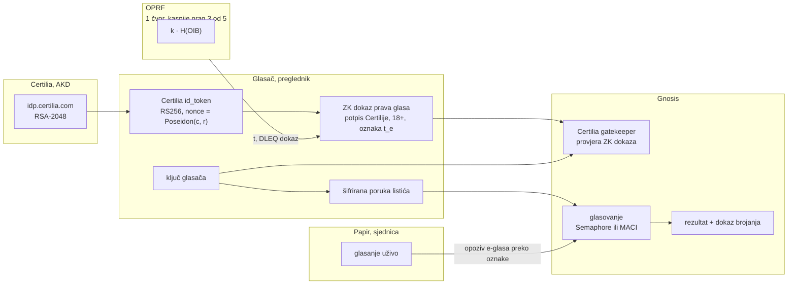

# 10 — Glasovanje: opći model

Članstvo u organizaciji nosi pravo upravljanja (`docs/03`). Ovaj dokument opisuje kako
se to pravo izvršava glasovanjem koje je provjerljivo i neporecivo: tko glasa, kako se
glas štiti i kako svatko može ponoviti zbroj. Isti model pokriva i glasovanja izvan
organizacija, sve do državnog eReferenduma.

**Stanje (20. 10. 2026.): plan.** Jedina radna instanca je glasanje javnosti za stadion
Maksimir (`stepanic/stadion-maksimir-natjecaj-2026`, na Gnosisu od 26. 9. 2026.).
Ovaj dokument je opći dio; izvedba stadiona ostaje u tom repou.

**Porijeklo.** Prenesen 20. 10. 2026. iz
`stadion-maksimir-natjecaj-2026/docs/2026-10-08-opci-model-glasovanja.md` (8. 10. 2026.)
s ugrađenim ispravcima neovisnog reviewa
`stadion-maksimir-natjecaj-2026/docs/review/2026-10-09-neovisni-review-opci-model-i-v2.md`
(nalazi E-01…E-15). Od tog datuma izvor istine za opći model je ovaj dokument.

Povezani dokumenti: Certilia (`docs/11`), lanac i neporecivost (`docs/12`), plan po
fazama (`docs/13`).

## Zaključak

Model je izvediv. Svaki poznati problem ima kriptografsko ili protokolarno rješenje
koje već radi negdje u svijetu. Ključna promjena u odnosu na stadion V1 je jedna:
**operaterov registrar zamjenjuje ZK dokaz Certilijinog potpisa.** Tada ugovor sam
provjerava da iza svakog glasača stoji prava Certilia prijava, i operater više ne može
upisati nijednog glasača. Ostatak je tajnost (šifrirani listići, MACI) i spoj s
glasanjem na papir.

## 1. Glasovanje u organizaciji

Za zajedno su to prvi slučajevi, redom od najjednostavnijeg:

| Slučaj | Biračko tijelo | Listić | Tajnost |
|---|---|---|---|
| Koji projekt organizacija pokreće sljedeći | članovi | jedan od N ili raspodjela bodova | anonimno prema javnosti |
| Javna anketa uz projekt („treba li klubu elektrana?”) | svi s Certilijom | DA/NE | anonimno prema javnosti |
| Odobrenje izmjene namjene sredstava projekta | podržavatelji projekta | DA/NE | anonimno prema javnosti |
| Izbor upravitelja ili tijela udruge | članovi | jedan od N, više mjesta | tajno prema operateru |
| Odluka skupštine udruge | članovi s pravom glasa | DA/NE po točki | po statutu |

Glasovanje ne pomiče novac. Safe projekta i dalje troše samo potpisnici (`docs/03`,
ograničenje 2). Glasovanje daje mandat i javni trag odluke, a potpisnici ga izvršavaju.

**Biračko tijelo organizacije je nova točka povjerenja.** Upravitelj vodi popis
članova, pa bi u popis mogao dodati osobe koje nisu članovi. To je isti oblik problema
kao A1, samo na razini organizacije. Mjere:

- član ulazi u popis samo vlastitom Certilia prijavom, uz odobrenje upravitelja;
- prije otvaranja glasovanja objavljuje se presjek popisa: broj članova i Merkle korijen
  njihovih oznaka (ne imena), a hash presjeka ide u definiciju glasovanja;
- svaki član sam provjerava je li u presjeku;
- broj članova je javan po organizaciji, pa se nagli skok prije glasovanja vidi.

**Statut odlučuje vrijedi li e-glas.** Za udruge to je pitanje statuta i Zakona o
udrugama, za župe kanonskog prava i odluke biskupije. Neprovjereno; otvoreno pitanje u
`docs/08`.

## 2. Pet osi glasovanja

Svako glasovanje opisuje se istom definicijom.

| Os | Mogućnosti | Stadion | Odluka kluba | Državni referendum |
|---|---|---|---|---|
| **Biračko tijelo** | svi s Certilijom / 18+ državljani / prebivalište u jedinici / popis članova | svi s Certilijom | presjek popisa članova | 18+ državljani RH |
| **Listić** | DA/NE, jedan od N, odobravanje, raspodjela bodova, rangiranje | 100 bodova na 88 radova | jedan od N | DA/NE po pitanju |
| **Vrijeme** | početak, kraj, smije li se mijenjati, presjeci | do 31. 12. 2027., mijenja se | npr. 7 dana | npr. 7 dana + dan papira |
| **Tajnost** | javno s imenom / pseudonim / anonimno prema javnosti / tajno i prema operateru | anonimno prema javnosti | po statutu | tajno prema svima |
| **Brojanje** | zbroj, kvorum, većina, prag | zbroj bodova | većina uz kvorum iz statuta | većina izašlih |

Definicija je javni dokument čiji hash ide u ugovor pri stvaranju glasovanja, pa se
pravila ne mogu tiho promijeniti:

```json
{
  "id": "nk-primjer-2027-uprava",
  "organizacija": { "map_ref": "clubs/nk-primjer" },
  "naslov": "Izbor predsjednika kluba",
  "biracko_tijelo": { "izvor": "clanstvo", "presjek": "0x…", "broj": 214, "dob_min": 18 },
  "listic": { "vrsta": "jedan_od_n", "opcije": 3 },
  "vrijeme": { "od": "2027-03-01T08:00+01:00", "do": "2027-03-07T20:00+01:00", "mijenjanje": true },
  "tajnost": { "razina": "tajno_prema_operateru", "dokaz_sadrzaja": false },
  "brojanje": { "pravilo": "vecina", "kvorum": 0.5 },
  "papir": { "ponistava_e_glas": true },
  "kljucevi": { "oprf_K": "0x…", "koordinator": "0x…" }
}
```

Svako glasovanje je instanca iz jedne tvornice ugovora (`docs/12`). Baza ima tablice
`glasovanje`, `glasovanje_opcija` i stupac `glasovanje_id` svugdje, bez prefiksa
pojedinog projekta.

## 3. Ciljna arhitektura



Tri promjene u odnosu na stadion V1:

1. **Upis bez registrara.** Ugovor provjerava ZK dokaz Certilijinog tokena (`docs/11`, `docs/12`).
2. **Šifrirani listići** gdje tajnost to traži. Na lancu su samo šifrirane poruke, a zbroj
   objavljuje koordinator s dokazom.
3. **Opoziv s papira ili sjednice.** Glas uživo poništava e-glas bez otkrivanja sadržaja.

## 4. Problemi i rješenja

Oznake u stupcu „Stadion V1” odnose se na `MaksimirGlasanjeV1` na Gnosisu. Detaljna
obrada svakog problema s dijagramima je u izvornom dokumentu (put gore); ovdje je
sažetak s ispravcima iz reviewa, označenima s E-xx.

### A. Identitet i pravo glasa

| # | Problem | Stadion V1 | Rješenje |
|---|---|---|---|
| **A1** | Operater (registrar) može upisati izmišljene glasače | otvoreno | ZK dokaz Certilijinog RS256 potpisa u pregledniku; ugovor provjerava Certiliju, ne nas |
| **A2** | Operater zna koji je glasač upisao koji commitment | otvoreno | commitment nastaje u pregledniku. Ostaje vremenski kanal: prijava, OPRF upit i upis u istom dahu kod istog operatera. Mjere: odgođena i skupna predaja, OPRF čvor kod drugog operatera (E-05) |
| **A3** | Jedinstvenost osobe bez OIB-a na lancu (OIB se pogađa brute forceom) | HMAC na serveru | OPRF: `t = k·H(OIB)`, DLEQ dokaz prema javnom `K` provjeren u krugu. Na lanac ide `t_e = Poseidon(t, glasovanjeId)`, pa se sudjelovanje iste osobe ne može povezati preko glasovanja (E-04). `K` je nepromjenjiv po glasovanju; prag se uvodi proaktivnim dijeljenjem istog `k`, jer novi `K` znači nove oznake i dvostruki upis (E-03) |
| **A4** | Punoljetnost | ne provjerava se | `birthdate` u dokazu, otkriva se samo „18+” |
| **A5** | Državljanstvo | ne provjerava se | `documentType` / `documentIssuingCountry` u dokazu, inače vjerodajnica registra birača |
| **A6** | Prebivalište (lokalni referendum) | ne provjerava se | potpisana vjerodajnica registra birača, isti ZK obrazac |
| **A6a** | Članstvo u organizaciji | — | presjek popisa članova s Merkle korijenom oznaka (§1) |
| **A7** | Izgubljen ključ, novi uređaj | ponovni upis s 24 riječi | nova prijava daje isti `t_e`; s MACI-jem promjena ključa za postojeće mjesto. Promjena kroz gatekeeper je javna transakcija s `t_e`, pa je prisilitelj vidi; tajna je samo promjena porukom starim ključem (E-08) |
| **A8** | Certilia ne radi ili je kompromitirana | — | višednevno glasanje, papir ili sjednica kao zamjena, javni brojač upisa uz gornju granicu biračkog tijela, samoprovjera „je li moja oznaka upisana” |
| **A9** | Proxy vidi `id_token` | da | `nonce = Poseidon(c, r)` sa soli `r`; klijent provjerava `nonce` u `authorization_url` prije otvaranja, jer bi ga proxy inače mogao zamijeniti i upisati svoj ključ (E-02); zaseban OIDC klijent za glasanje |

### B. Tajnost, prisila i kupovina glasova

| # | Problem | Stadion V1 | Rješenje |
|---|---|---|---|
| **B1** | Listić je na lancu čitljiv, a glasač zna svoj nullifier: potvrda za kupca | da | šifrirani listići (MACI ili prag-ElGamal) |
| **B2** | Međurezultati utječu na glasače | uživo javni | zbroj se dešifrira tek nakon zatvaranja |
| **B3** | Prisila kod kuće | mijenjanje glasa | ponovno glasanje koje se ne vidi izvana + papir poništava e-glas (Estonija od 2005.) |
| **B4** | Prodaja ključa | moguća | MACI tajna promjena ključa (uz ogradu iz A7) |
| **B5** | Kriptografski dokaz sadržaja glasa | postoji | u tajnom načinu samo „glasao sam”; u anketnom javno dijeljenje ostaje |
| **B6** | IP adresa i vrijeme predaje | relayer vidi IP | Oblivious HTTP, skupna predaja |
| **B7** | Mali anonimni skup | upozorenje | minimalna veličina biračkog tijela prije otvaranja; s MACI-jem tajnost ne ovisi o veličini. **Za župu ili klub s 30 članova ovo je glavni problem**: Semaphore ih skriva samo među 30 |
| **B8** | Tko je glasao | operater zna | na lancu je samo `t_e`, nepovezan s osobom bez ključa `k` |

### C. Integritet i provjerljivost

| # | Problem | Stadion V1 | Rješenje |
|---|---|---|---|
| **C1** | Zaraženo računalo mijenja glas | — | provjera drugim uređajem (Estonija) ili povratni kodovi (Švicarska). S MACI-jem to znači dešifriranje vlastite poruke ECDH tajnom na drugom uređaju (E-15) |
| **C2** | Zlonamjeran web kôd | — | otvoren kôd, ponovljiva izgradnja, hash izdanja u definiciji, neovisni klijenti |
| **C3** | Relayer ne preda listić | svatko može predati | više relayera, glasač provjerava svoj listić na lancu |
| **C4** | Točnost zbroja | zbroj u ugovoru | ZK dokaz brojanja (MACI) ili dokaz dešifriranja |
| **C5** | Greške u ugovoru | audit, mutacije, fuzz | uz to formalna verifikacija, bug bounty, pilot s paralelnim brojanjem |
| **C6** | Trusted setup | PSE ceremonija | ceremonija s mnogo sudionika ili univerzalni SRS (PLONK, UltraHonk) |
| **C7** | Rizici lanca | Gnosis + OTS | više sidara (Gnosis, Bitcoin OTS), puna kopija podataka, rok s rezervom |
| **C8** | Kvantna računala | — | ZK dokazi su savršeno skrivajući; šifrati se brišu nakon brojanja |
| **C9** | Skala | nije mjereno | gas za upise, vrijeme dokaza koordinatora, propusnost OPRF-a, dokaz na slabom Androidu. Za organizacije (desetci do tisuće glasača) nije prepreka; za državnu razinu nema brojke (E-09) |

### D. Papir, zakon i povjerenje

| # | Problem | Stadion V1 | Rješenje |
|---|---|---|---|
| **D1** | Papir poništava e-glas | — | odbor dobije oznaku osobe preko OPRF-a i objavi opoziv. Poništava se pri brojanju, ne uživo (Estonija isto); pad OPRF-a na dan papira ne smije dati dvostruko brojanje (E-10) |
| **D2** | GDPR | ništa osobno na lancu | `t_e` je pseudonimizirani osobni podatak, ne „ništa osobno” (E-06); DPIA, pravna osnova, brisanje izvan lanca |
| **D3** | Zakon i certifikacija | neslužbeno | pilot → organizacije → potpisi za inicijativu → izmjena zakona, certifikacija po CM/Rec(2017)5 |
| **D4** | Povjerenje javnosti | dokumentacija, skripte | neovisni provjeravatelji pokreću provjeru sami; javni sažetak svake prekretnice |
| **D5** | Sustav vezan uz jedan projekt | da | definicija s pet osi, tvornica ugovora, generička shema (§2) |
| **D6** | Dostupnost | — | papir ili sjednica ostaju ravnopravan kanal |

## 5. Što rješava matematika, a što organizacija

Matematika rješava integritet: tko nema Certilijin potpis, ne glasa; nitko ne glasa
dvaput; nitko ne mijenja ni briše glas; zbroj je provjerljiv. Za tajnost i prisilu
matematika daje alate, ali svaki se oslanja na organizacijsku pretpostavku. Te se
pretpostavke kažu javno:

| Svojstvo | Alat | Pretpostavka |
|---|---|---|
| Tajnost listića | MACI, prag-ElGamal | ne udruže se 3 od 5 koordinatora |
| Tko je glasao | OPRF | ne udruže se 3 od 5 OPRF čvorova (na početku: jedan čvor) |
| Pseudonimizacija `t_e` | OPRF + Poseidon po glasovanju | isto kao gore (E-06) |
| Otpornost na prisilu | tajno ponovno glasanje, promjena ključa | prisila ne traje do zatvaranja |
| Glas kako je htio | drugi uređaj, povratni kodovi | nisu zaražena oba uređaja |
| Identitet | RSA potpis Certilije | AKD ne izdaje lažne identitete |
| Biračko tijelo organizacije | presjek s Merkle korijenom, samoprovjera | upravitelj ne upisuje nečlanove, ili ga članovi otkriju |
| Skala | rollup, agregacija | neisprobano (E-09) |

## 6. Izvori

- Certilia OIDC: [discovery](https://idp.certilia.com/oauth2/oidcdiscovery/.well-known/openid-configuration), [JWKS](https://idp.certilia.com/oauth2/jwks)
- [Anon Aadhaar](https://github.com/anon-aadhaar/anon-aadhaar), [zkLogin](https://docs.sui.io/concepts/cryptography/zklogin), `zkemail/noir-jwt`
- [MACI](https://maci.pse.dev), [Semaphore](https://docs.semaphore.pse.dev), [ElectionGuard](https://www.electionguard.vote)
- [RFC 9497, OPRF](https://www.rfc-editor.org/rfc/rfc9497), [RFC 9458, Oblivious HTTP](https://www.rfc-editor.org/rfc/rfc9458)
- Estonija: [i-voting](https://www.valimised.ee/en/internet-voting-estonia), [statistika](https://www.valimised.ee/en/archive/statistics-about-internet-voting-estonia)
- Vijeće Europe: [CM/Rec(2017)5](https://rm.coe.int/0900001680726f6f)
