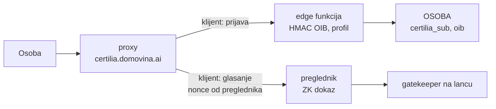

# 11 — Certilia: identitet

Certilia je jedini izvor identiteta platforme (odluka 3, `CLAUDE.md`). Služi dvjema
namjenama s različitim zahtjevima:

| Namjena | Što treba | Gdje se provjerava |
|---|---|---|
| **Prijava** (profil, članstvo, zastupnik, ime na listi podržavatelja) | OIB i ime, jednom po sesiji | na serveru (`energy.domovina.ai/docs/03` E7) |
| **Glasovanje** (`docs/10`) | dokaz da iza glasača stoji prava prijava, bez veze OIB → glas | u ZK krugu u pregledniku, a ugovor provjerava dokaz (`docs/12`) |

Prijava je obična OIDC integracija. Glasovanje traži više od tokena: token mora biti
vezan uz glasačev ključ, a server ga ne smije moći iskoristiti za tuđi ključ.

**Stanje (20. 10. 2026.):** u ovom projektu Certilia ne postoji (`docs/09` §1). Radna
integracija postoji u glasanju za stadion Maksimir od 25. 9. 2026. i ovdje se
preuzima, ne piše ponovno.

## 1. Što postoji

| Dio | Gdje | Što radi |
|---|---|---|
| Proxy | `stepanic/flutter_certilia`, `certilia-server/`, na `certilia.domovina.ai` (Coolify) | drži client secret, radi PKCE i razmjenu koda, polling sesije |
| Edge funkcija | `domovinatv/domovina-api`, `supabase/functions/certilia/index.ts` | provjerava `id_token` (potpis, `iss`, `aud`), sprema HMAC OIB-a i šifrirani OIB |
| Web klijent | `stadion-maksimir-natjecaj-2026/web/src/glasanje.ts`, `signInWithCertilia` | otvara prozor prijave, čeka rezultat pollingom |

Provjereno u kodu 20. 10. 2026.

## 2. Činjenice o Certiliji

Iz javnog [discovery dokumenta](https://idp.certilia.com/oauth2/oidcdiscovery/.well-known/openid-configuration)
i [JWKS-a](https://idp.certilia.com/oauth2/jwks), provjereno 8. 10. 2026.:

- `iss` je `https://idp.certilia.com/oauth2/token`; JWKS ima jedan ključ, **RSA-2048, RS256**.
  To je isti oblik potpisa koji dokazuju Anon Aadhaar i zkLogin.
- OIB stiže kao `sub`.
- `claims_supported` uključuje `birthdate`, `documentType`, `documentIssuingCountry`,
  `documentExpirationDate`, `address`, `acr`, `pin`.
- Token endpoint traži client secret (`client_secret_basic` ili `client_secret_post`).
  Zato treba proxy, osim ako AKD izda javnog PKCE klijenta.

**Neprovjereno** (stadion V2 plan, korak P0.1): jesu li `birthdate` i `nonce` stvarno u
našem `id_tokenu`, kolika je duljina tokena i nosi li fotografiju (`thumbnail`).

## 3. Poznati problemi postojeće integracije

| Problem | Mjesto | Posljedica | Popravak |
|---|---|---|---|
| Nonce generira proxy, klijent ga ne može zadati | `certilia-server/src/controllers/authController.js:100` | token se ne može vezati uz glasačev ključ | `initialize` prima `nonce` od klijenta |
| Proxy provjerava `nonce` samo ako postoji | `authController.js:285-287` | token bez `nonce` prolazi | stroga provjera |
| Proxy može zamijeniti `nonce` ili `redirect_uri` u `authorization_url` | tok prijave | upis proxyjevog ključa uz glasačevu prijavu (E-02) | klijent provjerava `nonce`, `client_id` i `redirect_uri` u URL-u prije otvaranja prozora |
| Edge funkcija provjerava samo potpis, `iss` i `aud` | `certilia/index.ts:71-74` | ukraden `id_token` vrijedi do `exp` | `nonce`, `maxTokenAge`, jednokratnost tokena |
| Sesije proxyja su u memoriji | `certilia-server` | restart prekida prijave u tijeku | sesije u Redisu ili KV-u |
| Token vjerojatno nosi fotografiju | proxy obrađuje `thumbnail` (`authController.js:280`) | token prevelik za SHA-256 u ZK krugu (E-01) | izmjeriti prije izbora kruga; po potrebi uži scope za glasanje |

## 4. Zamke iz produkcije

- **Rate limit proxyja:** 100 zahtjeva u 15 minuta po IP-u na cijelom `/api`. Na iPhoneu
  se prozor prijave zbog toga odmah zatvarao, pa je od 2. 10. 2026. polling
  (`GET /auth/polling/:id/status`) izuzet. `Retry-After` nije izložen kroz CORS. Detalji:
  `stadion-maksimir-natjecaj-2026/docs/2026-10-02-glasaj-vise-sucelja.md`, poglavlje
  „Prijava na iPhoneu”.
- **Prozor prijave mora se otvoriti izravno iz klika**, inače ga preglednik blokira
  (`glasanjeView.ts`, komentar uz `signInWithCertilia`).
- **Restart proxyja** briše sesije i brojač limita.

## 5. Kako zajedno koristi Certiliju

- **Dva OIDC klijenta.** Jedan za prijavu, drugi samo za glasanje. Token iz obične
  prijave tako ne vrijedi kao dokaz za upis glasača (stadion V2 plan, P3.1).
- **Jedan proxy** za oba, s popravcima iz §3, umjesto nove integracije po projektu.
- **OIB se ne sprema u čistom obliku.** U bazi je HMAC za jedinstvenost i šifrirani
  OIB samo gdje ga traži zakon ili Monerium. `OSOBA.oib` u `docs/03` treba to pratiti.

## 6. Otvorena pitanja

1. Može li AKD izdati javnog PKCE klijenta bez client secreta? Tada proxy nije potreban
   za glasanje.
2. Mjerenje tokena (P0.1): duljina, prisutnost `nonce`, `birthdate`, `thumbnail`,
   `exp − iat`, `kid`, RSA eksponent; razlika eOsobna i mobile.ID. Bilježi se samo
   prisutnost i oblik, nikad vrijednosti.
3. Daje li uži scope (bez `profile`/`eid`) token bez fotografije, a i dalje s OIB-om i
   `birthdate`?
4. Uvjeti AKD-a za korištenje Certilije za glasovanje u organizacijama.
