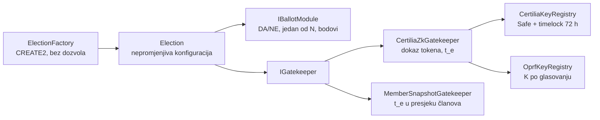

# 12 — Glasovanje na lancu: neporecivost

Cilj je da nakon zatvaranja glasovanja nitko, ni operater ni organizacija, ne može
tvrditi drukčiji rezultat, a da to svatko ne može provjeriti sam. Lanac je javna ploča
obavijesti, ne jedini zapis.

**Stanje (20. 10. 2026.):** stadion V1 radi na Gnosisu od 26. 9. 2026. Tvornica i
gatekeeper iz §3 su plan (`docs/13`).

## 1. Što znači neporecivo

| Svojstvo | Kako se postiže | Tko provjerava |
|---|---|---|
| Pravila se ne mijenjaju tiho | hash definicije (`docs/10` §2) upisan u ugovor pri stvaranju | bilo tko, usporedbom s objavljenom definicijom |
| Samo pravi glasači | ZK dokaz Certilijinog potpisa, oznaka `t_e` jednom po glasovanju | ugovor, pri svakom upisu |
| Nitko ne briše ni mijenja tuđi glas | ugovor bez nadogradnje i pauze; samo glasač s ključem mijenja svoj listić | ugovor |
| Glas je stigao | glasač vidi svoju poruku na lancu | glasač |
| Zbroj je točan | javni zbroj u ugovoru (Semaphore) ili ZK dokaz brojanja (MACI) | bilo tko, skriptom za provjeru |
| Zapis postoji i ako lanac nestane | lanac hasheva izvan lanca + OpenTimestamps sidro u Bitcoinu + puna kopija | bilo tko |

## 2. Što postoji: stadion V1

| Dio | Gdje (`stadion-maksimir-natjecaj-2026`) |
|---|---|
| Ugovor bez nadogradnje i pauze, vlasnik Safe 2/3 | `chain/contracts/v1/MaksimirGlasanjeV1.sol` |
| Semaphore ključ u pregledniku (passkey + 24 riječi) | `docs/blockchain/06-kontrola-glasaca.md` |
| Relayer bez ovlasti, glasač ne treba novčanik | `docs/blockchain/02-relayer-i-gas.md` |
| Lanac hasheva + OTS, checkpoint i neovisna provjera | `glasanje/README.md`, `scripts/maksimir_checkpoint.py`, `scripts/maksimir_verify.py` |
| Selidba V1 → nasljednik nullifierom | `docs/blockchain/07-verzioniranje.md` |
| 100 % pokrivenost, fuzz s referentnim modelom, mutacije vezane uz sigurnosne ciljeve, `check-frozen` | `docs/blockchain/audit/` |
| Tri neovisna reviewa (F-01…F-37, E-01…E-15) | `docs/review/README.md` |
| Javni sažetak prelaska na Gnosis | `docs/2026-09-26-dan-d.md` (`/glasanje-dan-d`) |

**Glavna rupa V1:** upis glasača potpisuje naš registrar (EIP-712), a ugovor ne vidi
Certiliju. Tko ima ključ registrara, može upisati izmišljene glasače, i njihovi se
glasovi ne mogu naknadno odvojiti od pravih. To je problem A1 (`docs/10`).

## 3. Ciljni ugovori

| Ugovor | Uloga |
|---|---|
| `ElectionFactory` | stvara instance, događaj `ElectionCreated(id, configHash)`; bez proxyja i dozvola |
| `Election` | semaphore ili MACI, gatekeeper, modul listića, `opensAt`, `closesAt`, scope, prethodnik; zbroj |
| `IBallotModule` | `validate(bytes)`, `deltas(old, new)`; po jedan modul po vrsti listića |
| `CertiliaZkGatekeeper` | provjerava dokaz iz `docs/11`, vraća `t_e`; instanca bilježi iskorištene oznake |
| `MemberSnapshotGatekeeper` | uz Certilia dokaz traži i Merkle dokaz da je `t_e` u presjeku članova organizacije (`docs/10` §1). Novo za zajedno, nije u stadion planu |
| `CertiliaKeyRegistry` | Certilijin `keyHash` + `kid`; dodaje Safe kroz timelock (72 h), opoziv 24 h, nikad retroaktivno |
| `OprfKeyRegistry` | javni ključ `K`; nepromjenjiv za glasovanje koje je otvoreno (E-03) |

**Sidro povjerenja.** Tvornica je bez dozvola, pa bilo tko može stvoriti instancu. Koja
je „prava” za organizaciju, kaže zapis na platformi i hash definicije koji organizacija
objavi (E-13). Organizacija zato objavljuje adresu instance na svojoj stranici i uz
projekt.

## 4. Semaphore ili MACI

| | Semaphore (stadion) | MACI |
|---|---|---|
| Listić na lancu | čitljiv, anoniman | šifriran |
| Rezultat | uživo, zbraja ugovor | nakon zatvaranja, koordinator s ZK dokazom |
| Dijeljenje vlastitog glasa | da | samo „glasao sam” |
| Otpornost na kupovinu glasa | ne | promjena ključa |
| Mali anonimni skup (župa s 30 članova) | slab | tajnost ne ovisi o veličini |
| Za zajedno | ankete, izbor projekta, javna mišljenja | izbori tijela, odluke skupštine |

Organizacija bira os tajnosti u definiciji; tvornica podržava oboje. MACI v3 već ima
politike upisa istog oblika (`AnonAadhaarPolicy`, `SemaphorePolicy`), pa je Certilia
gatekeeper jedan modul više.

## 5. Lanac i troškovi

- **Gnosis Chain**, isti lanac kao Safeovi projekata (`docs/06`). Napojnica ≥ 0,01 gwei;
  verifikacija ugovora preko Sourcify v2.
- **Glasač ne plaća gas.** Relayer predaje paket; nema ovlasti, pa ga može predati i
  bilo tko drugi. Trošak relayera snosi platforma (odluka 5: bez naknada).
- **Testna mreža:** Chiado, kao kod stadiona i sandbox raila.

## 6. Dva Safea, dvije uloge

Organizacija već ima Safe po projektu za novac. Glasovanje ne dira taj Safe. Vlasnik
instance glasovanja (Safe platforme ili organizacije) smije samo ono što ugovor dopušta:
nasljednika i registar ključeva kroz timelock, nikad listiće ni zbroj.
