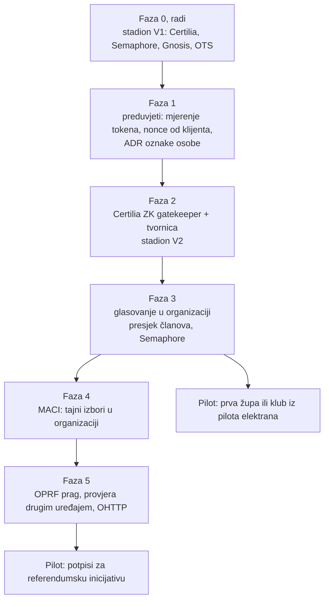

# 13 — Plan glasovanja

Redoslijed od stadiona do glasovanja u bilo kojoj organizaciji. Stadion Maksimir ostaje
živa referentna instanca: na njemu se svaka faza prvo isproba na stvarnim glasačima, a
tek onda nudi organizacijama.

**Stanje (20. 10. 2026.):** faza 0 radi. Detaljan plan stadiona V2 (P0–P7) je u
`stadion-maksimir-natjecaj-2026/docs/blockchain/09-v2-plan.md` i ostaje tamo, jer opisuje
kod tog repoa. Ovdje je opći redoslijed i ono što je specifično za organizacije.

| Faza | Što | Rješava (`docs/10`) | Gdje se radi |
|---|---|---|---|
| 0 | stadion V1 na Gnosisu | — | stadion repo, gotovo |
| 1 | preduvjeti | E-01, E-02, E-03, E-04, E-11 | stadion repo + proxy |
| 2 | ZK gatekeeper, tvornica, stadion V2 | A1, A2, A4, A5, A9, D5 | stadion repo (P1–P6) |
| 3 | glasovanje u organizaciji | A6a, B7 (dio) | ovaj repo |
| 4 | MACI instanca | B1–B4, C4 | tvornica, novi modul |
| 5 | prag i provjere | A3 (prag), B6, C1, C2 | proxy, OPRF čvorovi, web |
| stalno | | C5–C9, D2–D6 | svugdje |

## Faza 1: preduvjeti

Redoslijed iz neovisnog reviewa (9. 10. 2026.), prije bilo kojeg koda V2:

1. **Mjerenje tokena (P0.1 + E-01 + E-11).** Jedna probna prijava; bilježe se samo
   duljina tokena, imena polja, `exp − iat`, prisutnost `nonce`, `birthdate`,
   `thumbnail`. Ako token nosi fotografiju, izbor kruga se grana prije spikea.
2. **Klijentska provjera `nonce` (E-02).** `signInWithCertilia` provjerava `nonce`,
   `client_id` i `redirect_uri` u `authorization_url`. Isti rizik postoji već u V1.
3. **ADR „oznaka osobe” (E-03, E-04, E-12).** `t_e = Poseidon(t, glasovanjeId)`, `K`
   nepromjenjiv po glasovanju, proaktivno dijeljenje za prag, ZK dokaz uz OPRF upit kao
   jedina obrana od rječničkog napada, prozor konačnosti upisa.
4. **C9 Skala** kao tablica hipoteza; mjeri se u spikeu kruga.
5. Tek onda spike kruga (circom ili Noir, po vremenu dokaza na mobitelu).

## Faza 3: glasovanje u organizaciji

Ovo je dio koji stadion nema i koji pripada ovom repou.

| Korak | Što | Gotovo kad |
|---|---|---|
| 3.1 | Entiteti `GLASOVANJE` i `PRESJEK_CLANOVA` u `docs/03` | ER dijagram i ograničenja |
| 3.2 | Tok „član se prijavi i potvrdi članstvo”: Certilia + odobrenje upravitelja | sequence u `docs/04` |
| 3.3 | Presjek popisa: Merkle korijen oznaka `t_e`, broj članova, hash u definiciji | objavljen prije otvaranja, član provjerava sebe |
| 3.4 | `MemberSnapshotGatekeeper` na tvornici iz faze 2 | testovi kao u stadionu: 100 %, mutacije |
| 3.5 | Minimalna veličina biračkog tijela za Semaphore način (B7) | pravilo u definiciji, npr. 50 |
| 3.6 | Stranica glasovanja po organizaciji, adresa instance uz projekt (E-13) | isto sučelje kao stadion `/glasaj` |
| 3.7 | Javni sažetak prvog glasovanja organizacije | stranica po uzoru na `/glasanje-dan-d` |

**Prvi slučaj za pilot:** članovi župe ili kluba iz pilota elektrana (`docs/02`) biraju
između dvije ili tri varijante projekta (veličina elektrane, lokacija). Odluka nije
pravno obvezujuća, ne pomiče novac i ne traži tajnost prema operateru, pa je dovoljan
Semaphore.

## Ovisnosti o drugim repoima

| Repo | Što treba |
|---|---|
| `stadion-maksimir-natjecaj-2026` | faze 1 i 2; tvornica i gatekeeper nastaju tamo i ostaju referentna izvedba |
| `flutter_certilia` (`certilia-server`) | nonce od klijenta, zaseban OIDC klijent za glasanje, sesije izvan memorije (`docs/11` §3) |
| `domovina-api` | edge funkcija: `nonce`, `maxTokenAge`, jednokratnost; opća shema `glasovanje_*` |
| `pay.domovina.ai` | ništa: glasovanje ne dira novac |

## Otvorena pitanja

Prenesena u `docs/08`.
